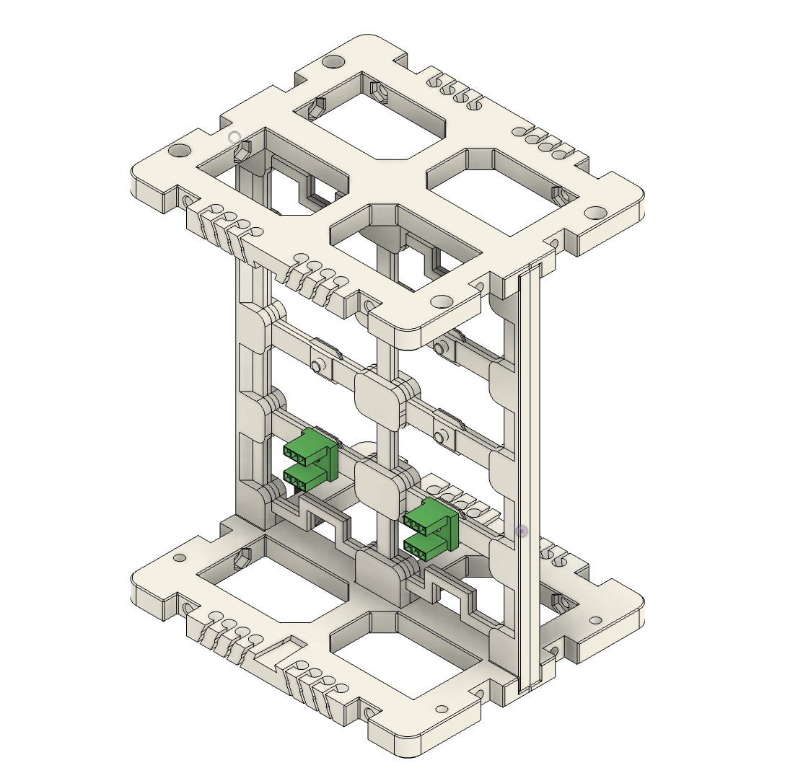
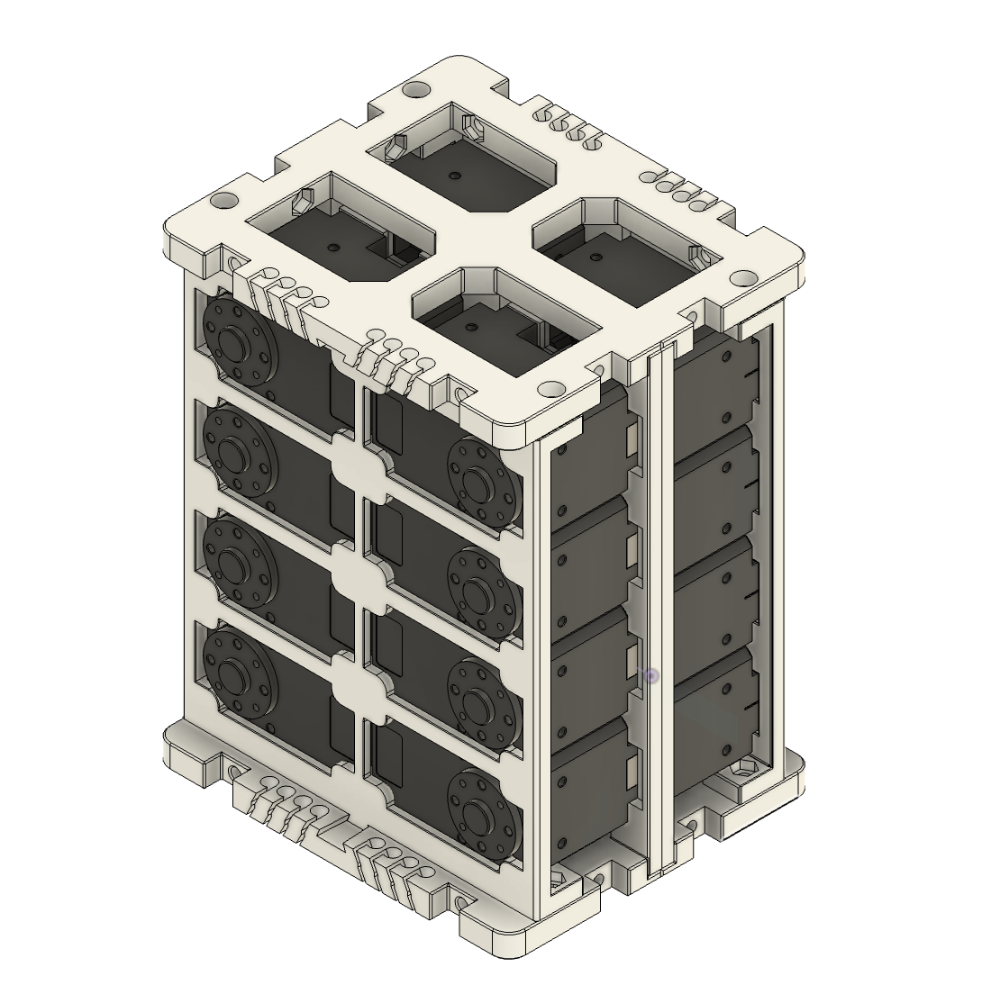
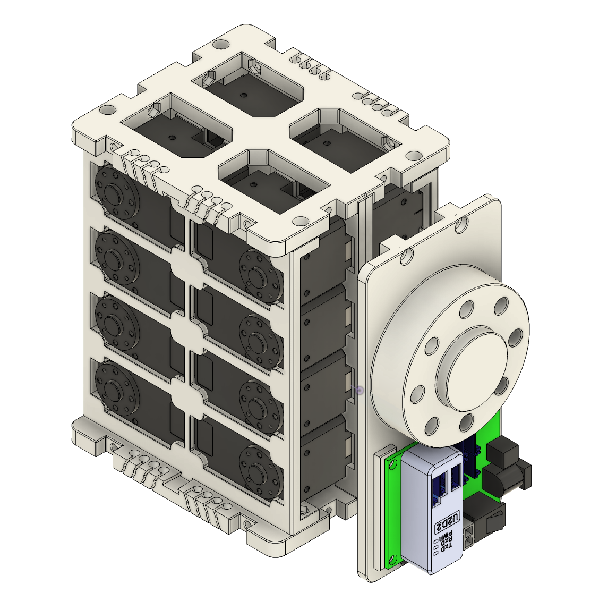
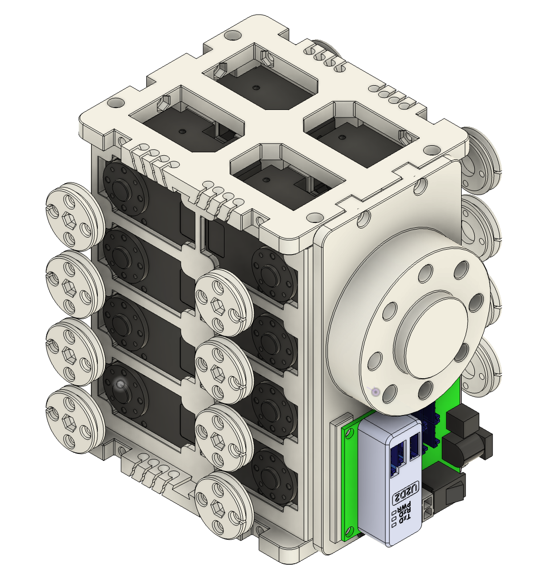
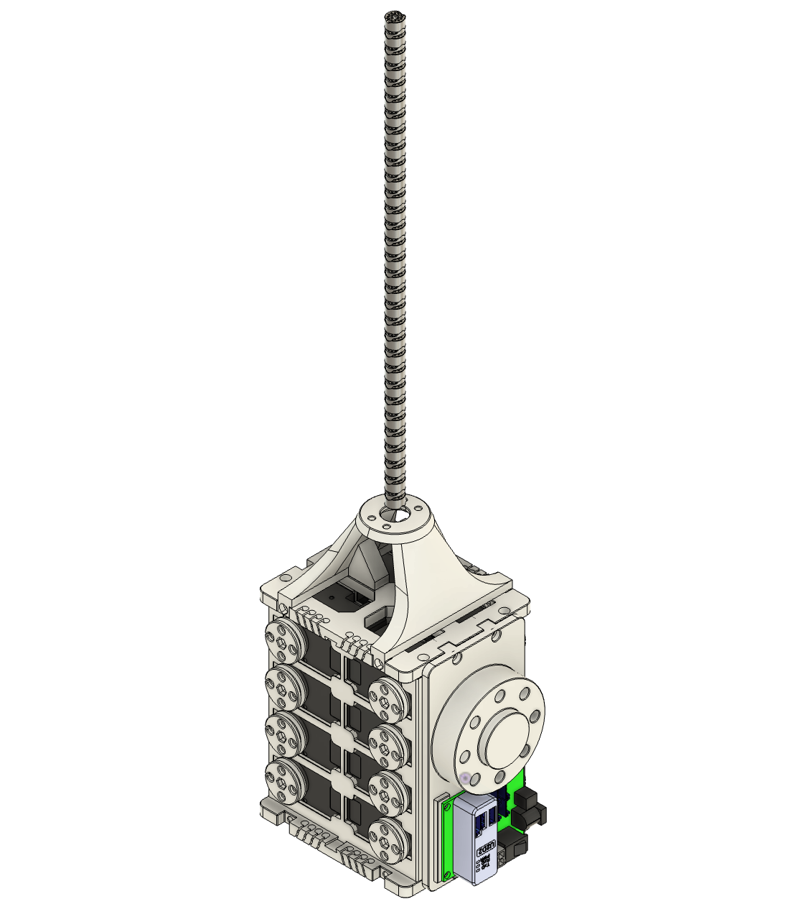

# Hardware and assembly

The supplied [`assembly.step`](../hardware/cad/assembly.step) is the reference for OpenTDCR. Open it in a STEP-capable CAD application to inspect the component tree, mating surfaces, and cable clearances. The [standalone mesh inventory](../hardware/README.md) and [BOM worksheet](../hardware/bom.csv) accompany it.

Inspection of the supplied STEP identifies an actuation module and mounts with 16 modeled servo-housing occurrences. The long flexible backbone is absent. The nine-tendon software example is therefore not an actuator map for the entire CAD assembly. A complete robot requires additional mechanical specifications and a verified assignment for the assembly's actuators.

The original build guide documents a modular servo frame, tendon spools, and a robot adapter. Its photographs are retained below as assembly context. They predate the supplied STEP export and are not proof that every photographed part is the same revision.

## What the supplied files establish

The design uses a frame around Dynamixel XL-430-style servo models, tendon spools, and U2D2 interface hardware. The standalone spool is named for a 10 mm radius. Mounts support attaching the mechanism to a robot arm, but an arm is not required by the standalone tendon-control software.

A CAD assembly does not specify a complete purchasing and manufacturing process. Backbone material and dimensions, tendon material and diameter, segment geometry, disk spacing, print settings, PCB details, exact fastener quantities, and the final servo-to-tendon map must be confirmed by the maintainers. These are explicit fields in the [release checklist](release-checklist.md).

## Prepare the parts

1. Compare every printable mesh against its matching body in the STEP assembly. Resolve the parts that lack standalone meshes before printing a complete build.
2. Confirm units, fit-critical dimensions, print material, orientation, infill, and tolerances for the intended loading. No validated print recipe was supplied.
3. Prepare the robot backbone, spacer disks, tendons, and adapter using the actual assembly drawing and measured specifications.
4. Inventory the servos, cables, U2D2, suitable power hardware, connector boards, and mechanical fasteners. The earlier guide lists M3 nuts and M3×8/10/14 screws for the frame, and M2×8 screws for spools/tendon fastening; verify each location rather than treating this as a complete BOM.

## Assemble the actuation frame

With power disconnected, fit the frame and connector boards, then insert the servos. Route cables so they cannot foul the spool or pinch between plates. Daisy-chain the servo columns and leave the interface connection accessible.

Connect the U2D2 interface and the appropriate servo power path according to the actual equipment manuals. USB alone is not a substitute for the servo supply. Verify polarity, connector compatibility, and supply ratings before power-up.

Fit the spools, check screw engagement, and secure the frame. Make sure each spool rotates without rubbing. Attach the robot adapter and route the tendons without crossing or abrasion at the guides.

## Configure and identify the servos

Use [ROBOTIS Dynamixel Wizard](https://emanual.robotis.com/docs/en/software/dynamixel/dynamixel_wizard2/) to identify each physical servo separately, record its model and firmware, and assign a unique ID. The legacy setup uses a 3 Mbps bus; the public configuration exposes the bus rate instead of assuming it matches every installation.

Create a wiring map from base segment to distal segment and from the first tendon around each segment. Record each servo's direction, effective spool radius, and tendon destination. A direction value is a measured property of tendon winding, not a property to infer from the servo ID.

Check the model-specific operating mode, voltage, and control table in the [ROBOTIS XL430-W250 manual](https://emanual.robotis.com/docs/en/dxl/x/xl430-w250/). The public driver targets that register layout; arbitrary Dynamixel models are not interchangeable.

## Establish a reference posture

Manually establish the intended neutral posture and appropriate tendon pretension, then verify each actuator with conservative increments. Do the first motor-direction checks with tendons loose or disconnected. Keep a physical means to remove actuator power within reach.

Capturing motor positions establishes coordinate zero; it does not calibrate tendon tension, determine geometric parameters, recover the posture after a reboot, or validate your sensor frame. The optional [calibration workflow](calibration.md) helps establish tendon references using measured tip displacement and configured countbacks; it still requires verified winding directions, geometry, and sensor transforms. See [measurement setup](measurements.md) before recording a reproducible experiment.

Once the assembly, wiring, limits, and reference posture have been checked, create a local reviewed configuration and follow [the hardware startup workflow](getting-started.md#connect-real-hardware).
